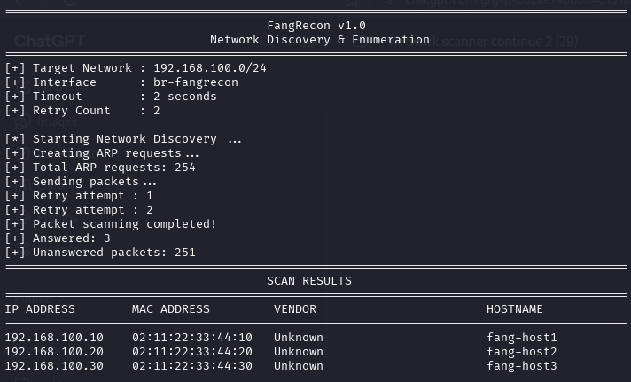
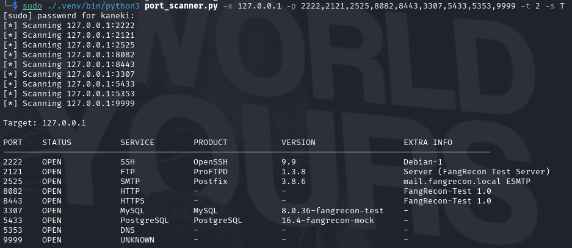
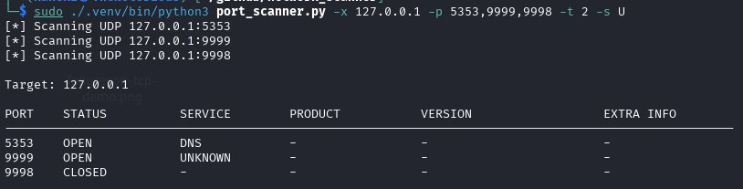
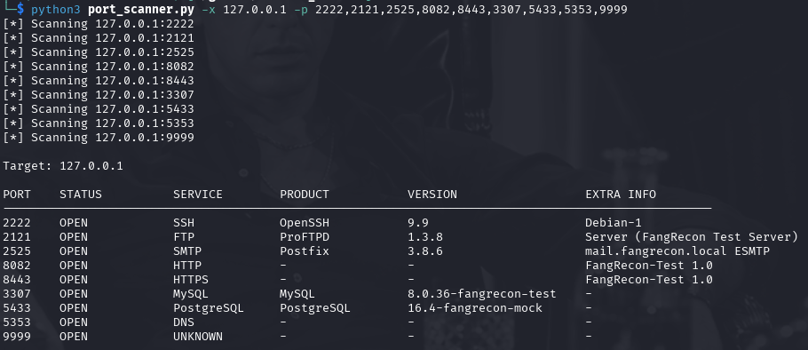

# FangRecon

**FangRecon** is a Python-based network reconnaissance tool designed to discover active devices, scan TCP and UDP ports, identify network services, and perform protocol-based version fingerprinting.

It combines ARP-based network discovery, concurrent port scanning, and service detection into a unified command-line tool.

## Features

- **Network Discovery:** Discover active devices using ARP scanning.
- **Host Identification:** Retrieve IP addresses, MAC addresses, vendors, and hostnames.
- **TCP Port Scanning:** Scan individual ports, custom ranges, and the default Top 1000 ports.
- **UDP Port Scanning:** Identify UDP port states using responses and ICMP information.
- **Service Detection:** Identify HTTP, HTTPS, SSH, FTP, SMTP, DNS, MySQL, and PostgreSQL.
- **Version Fingerprinting:** Extract available service banners, product names, and versions.
- **Concurrent Scanning:** Improve scanning performance through multithreading.
- **Unified CLI:** Access discovery and port scanning through one command.
- **Easy Installation:** Automated setup using a Python virtual environment.

## Technologies

- Python
- Scapy
- Socket Programming
- dnspython
- mac-vendor-lookup
- ThreadPoolExecutor
- Linux networking

## Installation

Clone the repository:

```bash
git clone https://github.com/TheNotoriousss/FangRecon.git
cd FangRecon
```

Run the installer:

```bash
./install.sh
```

Verify installation:

```bash
fangrecon --help
```

## Usage

FangRecon provides two main commands:

- `discovery` — Network host discovery.
- `ports` — TCP and UDP port scanning.

### View available options

```bash
fangrecon --help
fangrecon discovery --help
fangrecon ports --help
```

### Network Discovery

Discover active devices on a local network:

```bash
sudo fangrecon discovery -ip 192.168.1.0/24 -in wlan0
```

### TCP Port Scanning

Scan selected TCP ports:

```bash
sudo fangrecon ports -x 192.168.1.1 -p 22,80,443 -s T
```

Scan the default Top 1000 ports:

```bash
sudo fangrecon ports -x 192.168.1.1
```

### UDP Port Scanning

Scan selected UDP ports:

```bash
sudo fangrecon ports -x 192.168.1.1 -p 53,123,161 -s U
```

## Demonstrations

### Network Discovery

<!-- IMAGE COMMENT: Place the network discovery screenshot here. Show discovered IP addresses, MAC addresses, vendors, and hostnames. -->



### TCP Port Scanning

<!-- IMAGE COMMENT: Place the TCP port scanning screenshot here. Show open ports and their detected services. -->



### Service Detection & Fingerprinting

<!-- IMAGE COMMENT: Place the service detection screenshot here. Highlight detected protocols, product names, and service versions. -->



### UDP Port Scanning

<!-- IMAGE COMMENT: Place the UDP scanning screenshot here. Show UDP port states and identified services. -->



## Performance Optimization

FangRecon uses concurrent scanning and optimized service-probe selection to reduce execution time.

Results from controlled local benchmarks:

| Test | Before | After | Improvement |
|---|---:|---:|---:|
| TCP scanning (100 filtered ports) | 202.96 s | 2.14 s | ~94.8× |
| UDP scanning (10 silent ports) | 25.22 s | 2.60 s | ~9.7× |
| Service detection (9 mock services) | 9.33 s | 0.22 s | ~42.4× |

*These results represent controlled local tests, not guaranteed real-world performance.*

## Testing

FangRecon includes a test suite containing:

- Protocol mock servers.
- Service detection tests.
- Negative tests for unexpected protocol responses.
- DNS, FTP, HTTP, HTTPS, SMTP, MySQL, and PostgreSQL tests.
- UDP scanning test utilities.

Test scripts and mock servers are located in the `tests/` directory.

Generate local test certificates when required:

```bash
bash tests/generate_test_cert.sh
```

The generated certificates and private keys are excluded from Git.

## Project Structure

```text
FangRecon/
├── docs/
│   └── assets/              # Demonstration screenshots
├── service_detection/       # Service detection modules
├── tests/                   # Mock servers and regression tests
├── fangrecon                # Unified CLI launcher
├── install.sh               # Installation script
├── network-scanner.py       # ARP network discovery
├── port_scanner.py          # TCP port scanning
├── udp_scanner.py           # UDP port scanning
├── port_utils.py            # Port utilities
├── requirements.txt         # Python dependencies
└── top-1000.txt             # Default port list
```

## Project Status

| Phase | Description | Status |
|---|---|---|
| 1 | Network Discovery | Completed |
| 2 | Scanner Improvements | Completed |
| 3 | TCP Port Scanning & Service Detection | Completed |
| 4 | UDP Port Scanning | Completed |
| 5 | Advanced Service & Version Fingerprinting | Completed |
| 6 | Performance Optimization | Completed |
| 7 | Final Integration | Completed |

## Disclaimer

FangRecon is intended for educational purposes and authorized security testing only.

Only scan networks and systems that you own or have explicit permission to assess. Unauthorized scanning may violate applicable laws and network policies.

FangRecon is a reconnaissance tool. It does not perform exploitation or attempt to authenticate to discovered services.

## About

FangRecon is a learning-oriented cybersecurity project focused on network discovery, port scanning, service identification, and protocol-based fingerprinting.

**Build. Break. Protect.**